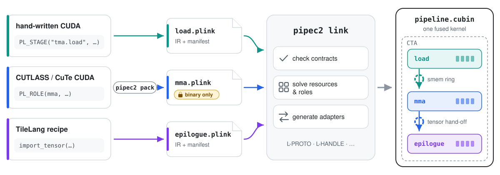
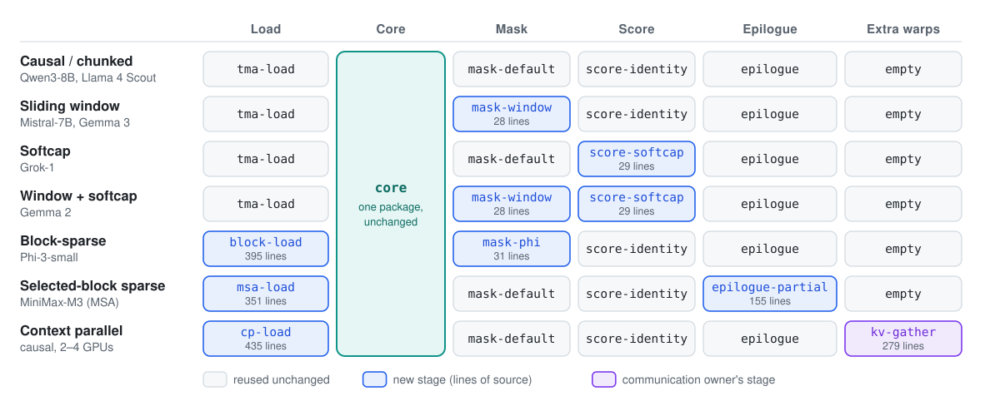

<h1 align="center">PipeLink</h1>

<p align="center">
  English | <a href="README.zh-CN.md">简体中文</a>
</p>

<p align="center">
  <b>A linker for partial GPU kernels.</b><br>
  Package CUDA pipeline stages separately, then link them into one fused kernel —<br>
  with contracts checked and resources bound at link time.
</p>

<p align="center">
  <a href="LICENSE"></a>
  
  
  
</p>

<p align="center">
  
</p>

Fused GPU kernels are usually written as one translation unit by one team. PipeLink
lets a load stage, an MMA mainloop, an epilogue, or a stage that exchanges data with
other GPUs come from different owners, toolchains and even binary-only packages, and
still run as **one kernel**, at the speed of the same code compiled together.

- 🧩 **Compose stages you did not write.** Each stage declares what it provides and needs;
  the linker checks every seam and rejects mismatches with a named diagnostic.
- 🔀 **Mix languages and libraries.** Hand-written CUDA, CUTLASS/CuTe, ThunderKittens and
  TileLang stages link into the same kernel; a TileLang epilogue consumes a CUTLASS
  accumulator as easily as its own, and a CuTe attention op runs inside a ThunderKittens
  megakernel.
- 🔒 **Keep your source.** Ship a stage as a `.plink` package (LTO IR + manifest) plus, for
  host-side setup, a provider library and a C header. Users compose it without ever seeing
  the code.
- ⚙️ **Let the linker do the plumbing.** Warp roles, shared memory, TMEM, registers,
  barriers and ring depths are solved at link time; tensor hand-offs between TMEM,
  shared memory and registers are generated. Across GPUs, the linker checks the
  readiness counters between stages and binds the peer memory that the caller provides.
- 🚀 **Pay nothing for the seam.** Linked kernels match the same sources compiled as one
  unit — never more than 0.3% slower across the showcases below.

> Paper coming soon.

## What you can build

| | Capability | Learn |
|---|---|---|
| 🔌 | **Callable seams** — call device functions exported by other packages | [T1](docs/tutorials/T1-hello-callable.md) |
| 🔁 | **Pipelines** — connect stages through mbarrier rings whose depth is chosen at link time | [T2](docs/tutorials/T2-ring-pipeline.md) |
| 🛡️ | **Contract checking** — swap a stage, or get `L-PROTO`, `L-HANDLE`, `L-PHASE`… instead of a hang | [T3](docs/tutorials/T3-contract-gallery.md) |
| 🧮 | **Generated tensor transport** — import an accumulator from TMEM, shared memory or registers without knowing where it lives | [T4](docs/tutorials/T4-tensor-import.md) |
| 📦 | **Binary-only stages** — ship a package plus a C header; persistent sessions and CUDA graph capture | [T5](docs/tutorials/T5-host-abi.md) |
| 🐍 | **TileLang stages** — author in TileLang, link against opaque CUDA | [T6](docs/tutorials/T6-tilelang.md) |
| 🌐 | **Multi-GPU overlap** — link another owner's communication stage into a compute kernel, so NVLink transfers overlap compute inside one kernel per GPU | [T7](docs/tutorials/T7-comm-overlap.md) |

## Showcases

### A whole-model megakernel that mixes ThunderKittens and CUTLASS

A 16-layer Llama-1B decode megakernel from
[Megakernels](https://github.com/HazyResearch/Megakernels), written with ThunderKittens,
is split into nine packages — an instruction interpreter plus eight ops — and relinked
into one persistent kernel that runs on datacenter Blackwell at **1.0001×** the throughput
of the same sources compiled as one unit (1.198 ms/token).

**CUTLASS and ThunderKittens code then share that kernel.** Replacing only the attention
package with one written in CUTLASS/CuTe leaves the other eight ThunderKittens packages,
the instruction schedule and the host code untouched. At a 4096-token context, the mixed
kernel decodes **2.19×** faster than the ThunderKittens-only kernel (1.701 ms/token),
and it matches its own one-unit build within 0.02%.
[Tour →](campaigns/megakernel/TOUR.md)

### An expert-parallel MoE training megakernel, owned by four teams

[Mixture-of-Kittens](https://github.com/cursor/mixture-of-kittens), a deterministic
expert-parallel MoE training megakernel, is split into a framework interpreter and three
op packages — communication, GEMM and activation — each owning its descriptors, shared
memory and synchronization. One set of op packages links into all 24 kernels (forward,
backward and recompute; BF16 and MXFP8; one or four GPUs; clamped or not), and the 12 timed
four-GPU kernels run within 0.9986–1.0002× of the same sources compiled as one unit and
within 0.989–1.008× of upstream MoK's whole step. A
comm-only tile change relinks without touching the other owners, and an activation owner
swaps in a GPT-OSS SwiGLU without the other owners' sources.
[Case study →](campaigns/mok/README.md)

### One epilogue, many producers

One unchanged epilogue source links against nine accumulator producers on three GPU
families:

- **Datacenter Blackwell:** tcgen05 accumulators in TMEM or shared memory, and TileLang.
- **Hopper:** WGMMA accumulators in registers or shared memory, and TileLang.
- **Consumer Blackwell:** `mma.sync` accumulators in registers or shared memory, and TileLang.

The linker generates each hand-off; the epilogue never learns where the accumulator
lives. Across the 18 linked kernels — each producer paired with a hand-written and a
TileLang epilogue — none is more than 0.06% slower than the same sources compiled as one
unit. [Example →](examples/one-epilogue-many-producers/README.md)

### One attention core, seven variants

One optimized dense attention core, derived from FlashAttention-3 on Hopper, is enough to
build very different attention kernels: each one links a few new stages around the same,
unchanged core package. A sliding window is a 28-line mask and softcapping is a 29-line
score function. Even kernels that schedule their work very differently, such as MiniMax-M3
sparse attention and attention split across GPUs, need only two new stages each, and they
perform competitively:

- **MiniMax-M3 sparse attention (MSA)** runs at 0.94–38× the speed of FA4, 1.5–40× that
  of FlexAttention and 1.6–4.5× that of
  [vLLM's dedicated Triton kernel](https://github.com/vllm-project/vllm/blob/3137ff07739f0cd19e06119506c6432a4a7e77ad/vllm/models/minimax_m3/common/ops/sparse_attn.py#L514).
  A new load stage visits only the selected key blocks, and a new epilogue writes partial
  results that a small kernel combines. FA4 and FlexAttention apply the selection as a mask
  over query tiles, so each tile computes every block that any of its queries selected: FA4 is 6%
  faster when the selected blocks form a prefix, and up to 38× slower when they are
  scattered.
- **Context-parallel attention with communication inside the kernel** speeds up causal
  prefill over 32K tokens by 1.95× on two GPUs and 3.66× on four, compared with one GPU,
  and runs 1.19–1.30× faster than Transformer Engine's context parallelism at 8K and 32K
  tokens on the same GPUs. A separate communication owner's stage pushes key/value shards
  to the other GPUs over NVLink, and the load stage waits for each remote block just
  before it loads it, so no separate gather or output-correction pass is needed.

<p align="center">
  
</p>

On dense and sliding-window attention the linked kernels reach 84–99% of FA3 and they
match it on chunked attention; on Phi-3 block-sparse attention they are 2.3–2.7× faster
than the fastest public kernel we measured. The remaining gaps to FA3 come from our core,
which every variant inherits; linking itself measures 1.000.
[Case study →](campaigns/attention/README.md)

## Get started

Requirements: Linux x86_64, CUDA 13.3 (`nvcc`, nvJitLink), a C++17 host compiler, Python 3
and [`uv`](https://docs.astral.sh/uv/). Packing and linking need no GPU. Running needs a
Hopper, datacenter Blackwell or consumer Blackwell GPU; T7 needs two to four Hopper GPUs
with peer access.

```sh
git clone --recursive https://github.com/alumkal/PipeLink.git && cd PipeLink
cp .env.example .env            # set PIPELINK_CUDA_HOME, PIPELINK_SCRATCH_ROOT and PIPELINK_GPUS
source tools/env.sh
uv run --project pipec --locked pipec2 --help
```

### Your first composition

A provider exports a device function; a caller uses it without ever seeing its source.

```cpp
// provider.cu
extern "C" __device__ float hello_scale(float value) { return value * 2.0f; }

PL_STAGE("org.hello.provider", "1.0.0");
PL_NO_PARAMS();
PL_EXPORT(scale, hello_scale);
PL_CALL(scale, hello_scale, pl::consume, "scale");
```

```cpp
// caller.cu (simplified)
extern "C" __device__ float pipelink_call_scale(float value);   // resolved at link time
extern "C" __device__ void hello_call(const void* raw, unsigned) {
    const auto* p = static_cast<const HelloCallerParams*>(raw);
    for (size_t i = blockIdx.x * blockDim.x + threadIdx.x; i < p->count; i += blockDim.x * gridDim.x)
        p->output[i] = pipelink_call_scale(p->input[i]);
}

PL_STAGE("org.hello.caller", "1.0.0");
PL_PARAMS(HelloCallerParams, input, output, count);
PL_ROLE(call, hello_call, 4);                                    // four warps
PL_CALL(scale, pipelink_call_scale, pl::produce, "call");
```

```sh
# Pick your GPU's profile: sm_90a, sm_100a, sm_103a, sm_120a or sm_121a.
uv run --project pipec --locked python examples/hello-callable/build.py --profile sm_120a   # pipec2 pack ×2, pipec2 link
uv run --project pipec --locked python examples/hello-callable/run.py   --profile sm_120a   # launch, check, time
```

`pipec2 link` derives the launch geometry, the params layout and the call trampoline; the
host side needs no hand-written launcher. Walk through it in [T1](docs/tutorials/T1-hello-callable.md).

### Tutorials

| Tutorial | GPU to run it |
|---|---|
| [T0](docs/tutorials/T0-pack-link.md) · Pack, inspect and link | None |
| [T1](docs/tutorials/T1-hello-callable.md) · Hello, callable seam | Any supported GPU |
| [T2](docs/tutorials/T2-ring-pipeline.md) · A pipeline through an mbarrier ring | Any supported GPU |
| [T3](docs/tutorials/T3-contract-gallery.md) · Swap a stage, break a contract | None |
| [T4](docs/tutorials/T4-tensor-import.md) · Generated tensor transport | Any supported GPU |
| [T5](docs/tutorials/T5-host-abi.md) · Ship a stage without source | Hopper for the full walkthrough |
| [T6](docs/tutorials/T6-tilelang.md) · Author a stage in TileLang | Any supported GPU |
| [T7](docs/tutorials/T7-comm-overlap.md) · Overlap communication with compute across GPUs | Two to four Hopper GPUs |
| [T8](docs/tutorials/T8-case-studies.md) · Case studies | None to read |

T4 and T6 need the [patched TileLang backend](frontends/tilelang/env/README.md).
The [documentation index](docs/index.md) covers what each profile supports.

## Scope

Generated code moves data exactly, within one CTA, and performs no arithmetic. Traffic
between CTAs or GPUs is written in stage code; the linker checks and binds its counters,
signals and peer or multicast memory over caller-named communication domains
([T7](docs/tutorials/T7-comm-overlap.md), [multimem-domains](examples/multimem-domains/README.md)). Tensor
imports carry one generation per export; multi-slot rings are written in stage code
([T2](docs/tutorials/T2-ring-pipeline.md)). The linker checks declarations, not the opaque
code behind them, so numerical checks and sanitizers stay part of every composition.

## Repository

| Path | Contents |
|---|---|
| [`pipec/`](pipec/README.md) | Compiler, package format and `pipec2` CLI |
| [`frontends/tilelang/`](frontends/tilelang/README.md) | TileLang authoring frontend |
| [`examples/`](examples/) | Teaching compositions |
| [`campaigns/`](campaigns/) | Attention, megakernel and MoE training case studies |
| [`evaluator/`](evaluator/) | Parity and evidence harness |
| [`docs/`](docs/index.md) | Tutorials and references |

Contributions are welcome — see [CONTRIBUTING.md](CONTRIBUTING.md). PipeLink is licensed
under [Apache-2.0](LICENSE); third-party portions keep their own licenses ([NOTICE](NOTICE)).
