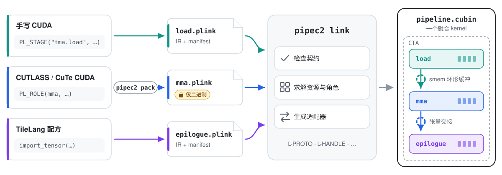
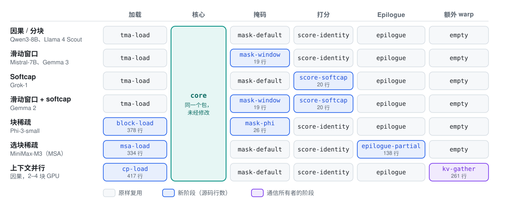

<h1 align="center">PipeLink</h1>

<p align="center">
  <a href="README.md">English</a> | 简体中文
</p>

<p align="center">
  <b>面向 GPU kernel 片段的链接器。</b><br>
  分别打包 CUDA 流水线的各个阶段，再把它们链接成一个融合 kernel——<br>
  在链接时检查契约、绑定资源。
</p>

<p align="center">
  <a href="LICENSE"></a>
  
  
  <a href="https://arxiv.org/abs/2610.37200"></a>
</p>

<p align="center">
  
</p>

融合 GPU kernel 通常由一个团队写成单个翻译单元。有了 PipeLink，它的各个阶段（加载阶段、MMA 主循环、epilogue、与其他 GPU 交换数据的阶段）可以来自不同的团队和工具链，甚至只以二进制包的形式提供，却仍作为**一个 kernel** 运行，速度与把同样的代码合并编译时相同。

- 🧩 **组合别人编写的阶段。** 每个阶段声明自己提供什么、需要什么；链接器检查每一处接缝，遇到不匹配就拒绝链接，并报告对应的诊断代码。
- 🔀 **混用语言与库。** 手写 CUDA、CUTLASS/CuTe、ThunderKittens 和 TileLang 阶段可以链接进同一个 kernel：TileLang epilogue 消费 CUTLASS 累加器就像消费自己的累加器一样容易，CuTe 注意力算子也能在 ThunderKittens megakernel 中运行。
- 🔒 **源码留在自己手里。** 以 `.plink` 包（LTO IR + manifest）发布阶段；需要主机端初始化时，再附带一个 provider 库和一个 C 头文件。使用者看不到代码也能组合它。
- ⚙️ **底层衔接交给链接器。** 链接器求解 warp 角色、共享内存、TMEM、寄存器、barrier 和环形缓冲深度，并生成 TMEM、共享内存与寄存器之间的张量交接代码。跨 GPU 时，它检查阶段之间的就绪计数器，并绑定调用方提供的对端内存。
- 🚀 **接缝零开销。** 在下方的展示案例中，链接得到的 kernel 比同样源码合并编译的版本最多慢 0.2%。

> 论文：[PipeLink: Contract-Guided Linking of GPU Kernel Components](https://arxiv.org/abs/2610.37200)

## 能构建什么

| | 能力 | 教程 |
|---|---|---|
| 🔌 | **可调用接缝**——调用其他包导出的 device 函数 | [T1](docs/tutorials/T1-hello-callable.md) |
| 🔁 | **流水线**——通过 mbarrier 环连接各阶段，环的深度在链接时选定 | [T2](docs/tutorials/T2-ring-pipeline.md) |
| 🛡️ | **契约检查**——替换一个阶段；契约不匹配时，链接直接失败并报告 `L-PROTO`、`L-HANDLE`、`L-PHASE` 等诊断，而不是让 kernel 挂起 | [T3](docs/tutorials/T3-contract-gallery.md) |
| 🧮 | **自动生成的张量传输**——从 TMEM 或寄存器导入累加器，无需关心它存放在哪里 | [T4](docs/tutorials/T4-tensor-import.md) |
| 📦 | **纯二进制阶段**——发布一个包和一个 C 头文件，支持持久会话和 CUDA graph 捕获 | [T5](docs/tutorials/T5-host-abi.md) |
| 🐍 | **TileLang 阶段**——用 TileLang 编写，与不透明的 CUDA 代码链接 | [T6](docs/tutorials/T6-tilelang.md) |
| 🌐 | **多 GPU 重叠**——把另一个团队的通信阶段链接进计算 kernel，使 NVLink 传输在每块 GPU 的单个 kernel 内与计算重叠 | [T7](docs/tutorials/T7-comm-overlap.md) |

## 展示案例

### 混合 ThunderKittens 与 CUTLASS 的整模型 megakernel

[Megakernels](https://github.com/HazyResearch/Megakernels) 中的 16 层 Llama-1B 解码 megakernel 用 ThunderKittens 编写。我们把它拆成九个包（一个指令解释器加八个算子），再重新链接为一个持久 kernel。在 sm103 上、SM 时钟锁定在 **1155 MHz** 时，在 1024 token 上下文、带 split-KV 归约的配置下，其吞吐为同样源码合并编译时的 **0.9996×**（1.149 ms/token），memcheck、racecheck 和 synccheck 均未报告问题。

**接着让 CUTLASS 加入这个 kernel。** 只把注意力包换成 CUTLASS/CuTe 版本，其余八个 ThunderKittens 包、指令调度和主机代码都不动。在 4096 token 的上下文下，混合 kernel 的解码耗时为 **1.630 ms/token**，吞吐是纯 ThunderKittens 版本的 **2.16×**，与其自身的合并构建相差不到 0.02%。[导览 →](campaigns/megakernel/TOUR.md)

### 四个团队分工负责的专家并行 MoE 训练 megakernel

[Mixture-of-Kittens](https://github.com/cursor/mixture-of-kittens) 是一个确定性的专家并行 MoE 训练 megakernel。我们把它拆成一个框架解释器和三个算子包（通信、GEMM 和激活），每个包各自管理描述符、共享内存和同步。同一组算子包可链接进全部 24 个 kernel（前向、反向和重计算；BF16 与 MXFP8；单 GPU 或四 GPU；带或不带 clamp）。其中参与计时的 12 个四 GPU kernel，性能是同样源码合并编译时的 0.9988–1.0007×，是上游 MoK 完整训练步的 0.989–1.014×。只改通信 tile 时重新链接即可，不涉及其他团队；负责激活的团队换入 GPT-OSS SwiGLU 时，也不需要其他团队的源码。[案例研究 →](campaigns/mok/README.md)

### 一个 SwiGLU 消费者，三个 GPU 系列

[CODA](campaigns/coda/README.md) 把 Qwen3-32B MLP 的 GEMM 与其 SwiGLU 激活融合在一起。每个 GPU 系列各有一个单独打包的 GEMM 生产者，累加器留在其硬件自然存放的位置：

- **数据中心 Blackwell：** 2-SM tcgen05 GEMM，累加器在 TMEM 中。
- **Hopper：** 三个 warpgroup 的 WGMMA GEMM，累加器在寄存器中。
- **消费级 Blackwell：** `mma.sync` GEMM，累加器在寄存器中。

每个生产者都与同一个手写 CUDA SwiGLU 消费者和同一个 TileLang 消费者链接。每次交接都由链接器生成，两个消费者都无需知道累加器在哪里。TileLang 消费者还可以按生产者特化，类似于剖析引导优化（PGO）：它直接采用生产者 manifest 中的布局，使寄存器交接变成普通的寄存器拷贝。在参与计时的 12 个 kernel 中（每个系列上两个消费者、两种批大小），没有一个比同样源码合并编译时慢 0.13% 以上。与“cuBLAS + 独立 SwiGLU”相比：SwiGLU 来自 `torch.compile` 时，链接得到的 kernel 在数据中心 Blackwell 上快 1.20–1.21×，来自 Liger 时快 1.34–1.37×；在 Hopper 上分别快 1.03–1.08× 和 1.12–1.18×；在消费级 Blackwell 上分别快 1.01–1.03× 和 1.05–1.08×。其速度为手写融合 kernel 的 0.94–1.01×。[案例研究 →](campaigns/coda/README.md)

### 一个注意力核心，七种变体

我们从 Hopper 上的 FlashAttention-3 派生出一个优化的稠密注意力核心，它能支撑差异很大的注意力 kernel：每个 kernel 只需在同一个未经修改的核心包周围链接几个新阶段。滑动窗口是一个 19 行的掩码，softcap 是一个 20 行的打分函数。即使是工作调度方式截然不同的 kernel，例如 MiniMax-M3 稀疏注意力和跨 GPU 拆分的注意力，也各自只需两个新阶段，性能依然有竞争力：

- **MiniMax-M3 稀疏注意力（MSA）** 的速度是 FA4 的 0.94–38×、FlexAttention 的 1.5–38×、[vLLM 专用 Triton kernel](https://github.com/vllm-project/vllm/blob/3137ff07739f0cd19e06119506c6432a4a7e77ad/vllm/models/minimax_m3/common/ops/sparse_attn.py#L514) 的 1.6–4.5×。新的加载阶段只访问选中的 key 块，新的 epilogue 写出部分结果，再由一个小 kernel 合并。FA4 和 FlexAttention 把选择作为掩码作用于 query tile，因此每个 tile 都要计算其中任一 query 选中的所有块：当选中的块构成前缀时，FA4 快 6%；当选中的块分散时，FA4 最多慢 38×。
- **在 kernel 内完成通信的上下文并行注意力**：对 32K token 的因果 prefill，与单 GPU 相比，两块 GPU 加速 1.95×，四块 GPU 加速 3.67×；在相同 GPU 上处理 8K 和 32K token 时，比 Transformer Engine 的上下文并行快 1.20–1.31×。通信团队的阶段通过 NVLink 把 key/value 分片推送到其他 GPU，加载阶段在加载每个远端块之前才等待它就绪，因此不需要单独的 gather 或输出修正 pass。

<p align="center">
  
</p>

在稠密注意力和滑动窗口注意力上，链接得到的 kernel 达到 FA3 的 84–99%，在分块注意力上与 FA3 持平；在 Phi-3 块稀疏注意力上，比我们测得的最快公开 kernel 快 2.3–2.7×。与 FA3 的剩余差距来自我们的核心，所有变体都继承了它；链接本身没有可测的开销：与同样源码合并编译相比，性能比为 1.000×。[案例研究 →](campaigns/attention/README.md)

## 快速开始

环境要求：Linux x86_64、CUDA 13.3（`nvcc`、nvJitLink）、C++17 主机编译器、Python 3 和 [`uv`](https://docs.astral.sh/uv/)。打包和链接不需要 GPU。运行需要 Hopper、数据中心 Blackwell 或消费级 Blackwell GPU；T7 需要两到四块支持 peer access 的 Hopper GPU。

```sh
git clone --recursive https://github.com/alumkal/PipeLink.git && cd PipeLink
cp .env.example .env            # 设置 PIPELINK_CUDA_HOME、PIPELINK_SCRATCH_ROOT 和 PIPELINK_GPUS
source tools/env.sh
uv run --project pipec --locked pipec2 --help
```

### 第一个组合

提供方导出一个 device 函数；调用方看不到其源码也能使用它。

```cpp
// provider.cu
extern "C" __device__ float hello_scale(float value) { return value * 2.0f; }

PL_STAGE("org.hello.provider", "1.0.0");
PL_NO_PARAMS();
PL_EXPORT(scale, hello_scale);
PL_CALL(scale, hello_scale, pl::consume, "scale");
```

```cpp
// caller.cu（简化版）
extern "C" __device__ float pipelink_call_scale(float value);   // 在链接时解析
extern "C" __device__ void hello_call(const void* raw, unsigned) {
    const auto* p = static_cast<const HelloCallerParams*>(raw);
    for (size_t i = blockIdx.x * blockDim.x + threadIdx.x; i < p->count; i += blockDim.x * gridDim.x)
        p->output[i] = pipelink_call_scale(p->input[i]);
}

PL_STAGE("org.hello.caller", "1.0.0");
PL_PARAMS(HelloCallerParams, input, output, count);
PL_ROLE(call, hello_call, 4);                                    // 四个 warp
PL_CALL(scale, pipelink_call_scale, pl::produce, "call");
```

```sh
# 选择与你的 GPU 对应的 profile：sm_90a、sm_100a、sm_103a、sm_120a 或 sm_121a。
uv run --project pipec --locked python examples/hello-callable/build.py --profile sm_120a   # pipec2 pack ×2，pipec2 link
uv run --project pipec --locked python examples/hello-callable/run.py   --profile sm_120a   # 启动、检查、计时
```

`pipec2 link` 推导出 launch 配置（grid/block 维度等）、params 布局和调用跳板（trampoline），主机端无需手写启动器。完整讲解见 [T1](docs/tutorials/T1-hello-callable.md)。

### 教程

教程和其他文档目前只有英文版。

| 教程 | 运行所需 GPU |
|---|---|
| [T0](docs/tutorials/T0-pack-link.md) · 打包、检查与链接 | 无 |
| [T1](docs/tutorials/T1-hello-callable.md) · Hello，可调用接缝 | 任意受支持的 GPU |
| [T2](docs/tutorials/T2-ring-pipeline.md) · 通过 mbarrier 环构建流水线 | 任意受支持的 GPU |
| [T3](docs/tutorials/T3-contract-gallery.md) · 替换阶段，破坏契约 | 无 |
| [T4](docs/tutorials/T4-tensor-import.md) · 自动生成的张量传输 | 任意受支持的 GPU |
| [T5](docs/tutorials/T5-host-abi.md) · 不带源码发布阶段 | 完整演练需要 Hopper |
| [T6](docs/tutorials/T6-tilelang.md) · 用 TileLang 编写阶段 | 任意受支持的 GPU |
| [T7](docs/tutorials/T7-comm-overlap.md) · 跨 GPU 重叠通信与计算 | 两到四块 Hopper GPU |
| [T8](docs/tutorials/T8-case-studies.md) · 案例研究 | 仅阅读，无需 GPU |

T4 和 T6 需要[打过补丁的 TileLang 后端](frontends/tilelang/env/README.md)。[文档索引](docs/index.md)说明了每个 profile 支持哪些功能。

## 适用范围

生成的代码在单个 CTA 内精确搬运数据，不做算术运算。CTA 之间或 GPU 之间的数据传输写在阶段代码中；链接器检查并绑定其计数器、信号，以及按调用方命名的通信域（communication domain）划分的对端内存或多播内存（[T7](docs/tutorials/T7-comm-overlap.md)、[multimem-domains](examples/multimem-domains/README.md)）。张量导入一次只交接所导出数据的一代（generation）；若要让多代数据同时在途，请在阶段代码中编写多槽环（[T2](docs/tutorials/T2-ring-pipeline.md)）。链接器只检查声明，不检查声明背后的不透明代码，因此每个组合仍需要数值检查和 sanitizer。

## 仓库结构

| 路径 | 内容 |
|---|---|
| [`pipec/`](pipec/README.md) | 编译器、包格式和 `pipec2` CLI |
| [`frontends/tilelang/`](frontends/tilelang/README.md) | TileLang 前端：用 TileLang 编写阶段 |
| [`examples/`](examples/) | 教学用组合示例 |
| [`campaigns/`](campaigns/) | 注意力、megakernel 与 MoE 训练案例研究 |
| [`evaluator/`](evaluator/) | 一致性（parity）测试与证据采集框架 |
| [`docs/`](docs/index.md) | 教程与参考文档 |

欢迎贡献——参见 [CONTRIBUTING.md](CONTRIBUTING.md)。PipeLink 采用 [Apache-2.0](LICENSE) 许可证；第三方部分保留各自的许可证（[NOTICE](NOTICE)）。

## 引用

如果 PipeLink 对你的研究有帮助，请引用：

```bibtex
@misc{guo2026pipelink,
  title         = {PipeLink: Contract-Guided Linking of GPU Kernel Components},
  author        = {Jize Guo and Xupeng Miao},
  year          = {2026},
  eprint        = {2610.37200},
  archivePrefix = {arXiv},
  primaryClass  = {cs.DC}
}
```
