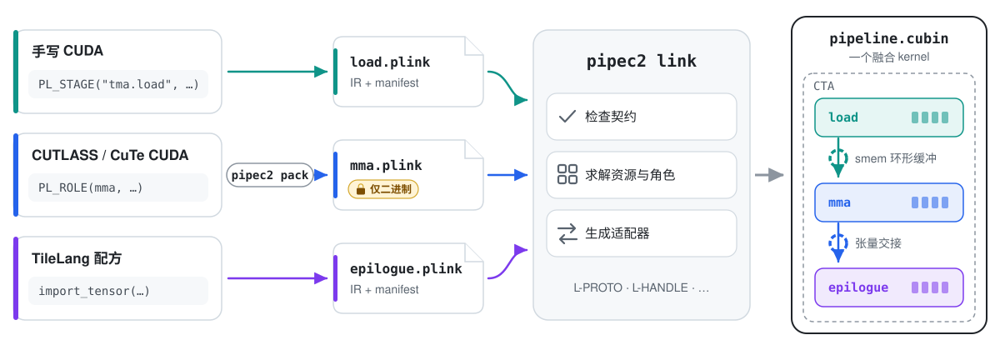
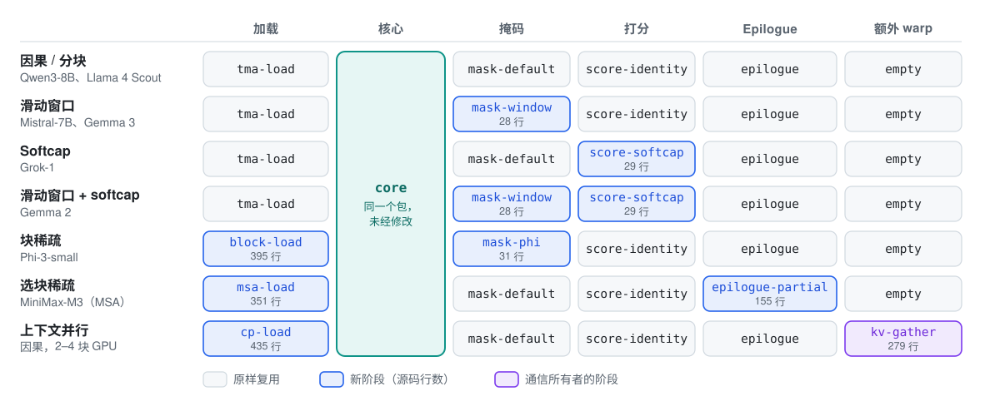

<h1 align="center">PipeLink</h1>

<p align="center">
  <a href="README.md">English</a> | 简体中文
</p>

<p align="center">
  <b>面向 GPU kernel 片段的链接器。</b><br>
  分别打包 CUDA 流水线的各个阶段，再把它们链接成一个融合 kernel——<br>
  在链接时检查契约、绑定资源。
</p>

<p align="center">
  <a href="LICENSE"></a>
  
  
  
</p>

<p align="center">
  
</p>

融合 GPU kernel 通常由一个团队写成单个翻译单元。PipeLink 允许加载阶段、MMA 主循环、epilogue，乃至与其他 GPU 交换数据的阶段分别来自不同的所有者和工具链，甚至是只提供二进制的包，却仍然作为**一个 kernel** 运行，速度与把同样的代码放在一起编译时相同。

- 🧩 **组合并非由你编写的阶段。** 每个阶段声明自己提供什么、需要什么；链接器检查每一处接缝，遇到不匹配时以具名诊断拒绝链接。
- 🔀 **混用语言与库。** 手写 CUDA、CUTLASS/CuTe、ThunderKittens 和 TileLang 阶段可以链接进同一个 kernel；TileLang epilogue 消费 CUTLASS 累加器就像消费自己的累加器一样容易，CuTe 注意力算子也能在 ThunderKittens megakernel 中运行。
- 🔒 **源码留在自己手里。** 以 `.plink` 包（LTO IR + manifest）的形式发布阶段；若需要主机端初始化，再附带一个 provider 库和一个 C 头文件。使用者无需看到代码即可组合它。
- ⚙️ **底层衔接交给链接器。** Warp 角色、共享内存、TMEM、寄存器、barrier 和环形缓冲深度都在链接时求解；TMEM、共享内存与寄存器之间的张量交接代码自动生成。跨 GPU 时，链接器检查阶段之间的就绪计数器，并绑定调用方提供的对端内存。
- 🚀 **接缝零开销。** 链接得到的 kernel 与同样源码单体编译的结果性能一致——在下方所有展示案例中，最多慢 0.3%。

> 论文即将发布。

## 能构建什么

| | 能力 | 教程 |
|---|---|---|
| 🔌 | **可调用接缝**——调用其他包导出的 device 函数 | [T1](docs/tutorials/T1-hello-callable.md) |
| 🔁 | **流水线**——通过 mbarrier 环连接各阶段，环的深度在链接时选定 | [T2](docs/tutorials/T2-ring-pipeline.md) |
| 🛡️ | **契约检查**——替换一个阶段，要么正常工作，要么得到 `L-PROTO`、`L-HANDLE`、`L-PHASE`……诊断，而不是程序挂起 | [T3](docs/tutorials/T3-contract-gallery.md) |
| 🧮 | **自动生成的张量传输**——从 TMEM、共享内存或寄存器导入累加器，无需知道它位于何处 | [T4](docs/tutorials/T4-tensor-import.md) |
| 📦 | **纯二进制阶段**——发布一个包和一个 C 头文件；支持持久会话和 CUDA graph 捕获 | [T5](docs/tutorials/T5-host-abi.md) |
| 🐍 | **TileLang 阶段**——用 TileLang 编写，与不透明的 CUDA 代码链接 | [T6](docs/tutorials/T6-tilelang.md) |
| 🌐 | **多 GPU 重叠**——把另一所有者的通信阶段链接进计算 kernel，使 NVLink 传输在每块 GPU 的单个 kernel 内与计算重叠 | [T7](docs/tutorials/T7-comm-overlap.md) |

## 展示案例

### 混合 ThunderKittens 与 CUTLASS 的整模型 megakernel

[Megakernels](https://github.com/HazyResearch/Megakernels) 中的 16 层 Llama-1B 解码 megakernel 用 ThunderKittens 编写。我们把它拆分为九个包——一个指令解释器加八个算子——再重新链接为一个持久 kernel。它在数据中心 Blackwell 上的吞吐是同样源码单体编译时的 **1.0001×**（1.198 ms/token）。

**随后，CUTLASS 与 ThunderKittens 代码共享这个 kernel。** 只把注意力包替换为用 CUTLASS/CuTe 编写的版本，其余八个 ThunderKittens 包、指令调度和主机代码都保持不变。在 4096 token 的上下文下，混合 kernel 的解码速度是纯 ThunderKittens kernel（1.701 ms/token）的 **2.19×**，且与其自身的单体构建相差不超过 0.02%。[导览 →](campaigns/megakernel/TOUR.md)

### 四个团队分工负责的专家并行 MoE 训练 megakernel

[Mixture-of-Kittens](https://github.com/cursor/mixture-of-kittens) 是一个确定性的专家并行 MoE 训练 megakernel。我们把它拆分为一个框架解释器和三个算子包——通信、GEMM 和激活——每个包各自管理自己的描述符、共享内存和同步。同一组算子包可链接进全部 24 个 kernel（前向、反向和重计算；BF16 与 MXFP8；单 GPU 或四 GPU；带或不带 clamp）。其中 12 个参与计时的四 GPU kernel，性能是同样源码单体编译时的 0.9986–1.0002×，是上游 MoK 完整训练步的 0.989–1.008×。仅涉及通信的 tile 改动只需重新链接，不必触碰其他所有者的代码；激活的所有者换入 GPT-OSS SwiGLU 时，也不需要其他所有者的源码。[案例研究 →](campaigns/mok/README.md)

### 一个 epilogue，多个生产者

一份未经修改的 epilogue 源码可与三个 GPU 系列上的九种累加器生产者链接：

- **数据中心 Blackwell：** TMEM 或共享内存中的 tcgen05 累加器，以及 TileLang。
- **Hopper：** 寄存器或共享内存中的 WGMMA 累加器，以及 TileLang。
- **消费级 Blackwell：** 寄存器或共享内存中的 `mma.sync` 累加器，以及 TileLang。

每一次交接都由链接器生成；epilogue 始终不知道累加器位于何处。在链接得到的 18 个 kernel 中（每个生产者分别搭配一个手写 epilogue 和一个 TileLang epilogue），没有一个比同样源码单体编译时慢 0.06% 以上。[示例 →](examples/one-epilogue-many-producers/README.md)

### 一个注意力核心，七种变体

一个由 Hopper 上的 FlashAttention-3 派生而来的优化稠密注意力核心，足以构建差异很大的注意力 kernel：每个 kernel 只需在同一个未经修改的核心包周围链接几个新阶段。滑动窗口只是一个 28 行的掩码，softcap 只是一个 29 行的打分函数。即使是工作调度方式截然不同的 kernel，例如 MiniMax-M3 稀疏注意力和跨 GPU 拆分的注意力，也各自只需要两个新阶段，并且性能颇具竞争力：

- **MiniMax-M3 稀疏注意力（MSA）** 的速度是 FA4 的 0.94–38×、FlexAttention 的 1.5–40×、[vLLM 专用 Triton kernel](https://github.com/vllm-project/vllm/blob/3137ff07739f0cd19e06119506c6432a4a7e77ad/vllm/models/minimax_m3/common/ops/sparse_attn.py#L514) 的 1.6–4.5×。新的加载阶段只访问被选中的 key 块，新的 epilogue 写出部分结果，再由一个小 kernel 合并。FA4 和 FlexAttention 把选择作为掩码作用于 query tile，因此每个 tile 都要计算其中任一 query 选中的所有块：当选中的块构成前缀时，FA4 快 6%；当选中的块分散时，FA4 最多慢 38×。
- **在 kernel 内完成通信的上下文并行注意力**：对于 32K token 以上的因果 prefill，与单 GPU 相比，两块 GPU 加速 1.95×，四块 GPU 加速 3.66×；在相同 GPU 上、8K 与 32K token 时，比 Transformer Engine 的上下文并行快 1.19–1.30×。一个独立通信所有者的阶段通过 NVLink 把 key/value 分片推送到其他 GPU，加载阶段则在加载每个远端块之前才等待它就绪，因此无需单独的 gather 或输出修正 pass。

<p align="center">
  
</p>

在稠密注意力和滑动窗口注意力上，链接得到的 kernel 达到 FA3 的 84–99%，在分块注意力上与 FA3 持平；在 Phi-3 块稀疏注意力上，它们比我们测得的最快公开 kernel 快 2.3–2.7×。与 FA3 的剩余差距来自我们的核心，所有变体都继承了它；链接本身的性能比测得为 1.000。[案例研究 →](campaigns/attention/README.md)

## 快速开始

环境要求：Linux x86_64、CUDA 13.3（`nvcc`、nvJitLink）、C++17 主机编译器、Python 3 和 [`uv`](https://docs.astral.sh/uv/)。打包和链接不需要 GPU。运行需要 Hopper、数据中心 Blackwell 或消费级 Blackwell GPU；T7 需要两到四块支持 peer access 的 Hopper GPU。

```sh
git clone --recursive https://github.com/alumkal/PipeLink.git && cd PipeLink
cp .env.example .env            # 设置 PIPELINK_CUDA_HOME、PIPELINK_SCRATCH_ROOT 和 PIPELINK_GPUS
source tools/env.sh
uv run --project pipec --locked pipec2 --help
```

### 第一个组合

提供方导出一个 device 函数；调用方无需看到其源码即可使用它。

```cpp
// provider.cu
extern "C" __device__ float hello_scale(float value) { return value * 2.0f; }

PL_STAGE("org.hello.provider", "1.0.0");
PL_NO_PARAMS();
PL_EXPORT(scale, hello_scale);
PL_CALL(scale, hello_scale, pl::consume, "scale");
```

```cpp
// caller.cu（简化版）
extern "C" __device__ float pipelink_call_scale(float value);   // 在链接时解析
extern "C" __device__ void hello_call(const void* raw, unsigned) {
    const auto* p = static_cast<const HelloCallerParams*>(raw);
    for (size_t i = blockIdx.x * blockDim.x + threadIdx.x; i < p->count; i += blockDim.x * gridDim.x)
        p->output[i] = pipelink_call_scale(p->input[i]);
}

PL_STAGE("org.hello.caller", "1.0.0");
PL_PARAMS(HelloCallerParams, input, output, count);
PL_ROLE(call, hello_call, 4);                                    // 四个 warp
PL_CALL(scale, pipelink_call_scale, pl::produce, "call");
```

```sh
# 选择与你的 GPU 对应的 profile：sm_90a、sm_100a、sm_103a、sm_120a 或 sm_121a。
uv run --project pipec --locked python examples/hello-callable/build.py --profile sm_120a   # pipec2 pack ×2，pipec2 link
uv run --project pipec --locked python examples/hello-callable/run.py   --profile sm_120a   # 启动、检查、计时
```

`pipec2 link` 会推导出 launch 配置（grid/block 维度等）、params 布局和调用跳板（trampoline）；主机端无需手写启动器。完整讲解见 [T1](docs/tutorials/T1-hello-callable.md)。

### 教程

教程和其他文档目前只有英文版。

| 教程 | 运行所需 GPU |
|---|---|
| [T0](docs/tutorials/T0-pack-link.md) · 打包、检查与链接 | 无 |
| [T1](docs/tutorials/T1-hello-callable.md) · Hello，可调用接缝 | 任意受支持的 GPU |
| [T2](docs/tutorials/T2-ring-pipeline.md) · 通过 mbarrier 环构建流水线 | 任意受支持的 GPU |
| [T3](docs/tutorials/T3-contract-gallery.md) · 替换阶段，破坏契约 | 无 |
| [T4](docs/tutorials/T4-tensor-import.md) · 自动生成的张量传输 | 任意受支持的 GPU |
| [T5](docs/tutorials/T5-host-abi.md) · 不带源码发布阶段 | 完整演练需要 Hopper |
| [T6](docs/tutorials/T6-tilelang.md) · 用 TileLang 编写阶段 | 任意受支持的 GPU |
| [T7](docs/tutorials/T7-comm-overlap.md) · 跨 GPU 重叠通信与计算 | 两到四块 Hopper GPU |
| [T8](docs/tutorials/T8-case-studies.md) · 案例研究 | 仅阅读，无需 GPU |

T4 和 T6 需要[打过补丁的 TileLang 后端](frontends/tilelang/env/README.md)。[文档索引](docs/index.md)说明了每个 profile 支持哪些功能。

## 适用范围

生成的代码只在单个 CTA 内精确搬运数据，不做任何算术运算。CTA 之间或 GPU 之间的数据传输写在阶段代码中；链接器检查并绑定其计数器、信号，以及按调用方命名的通信域（communication domain）划分的对端内存或多播内存（[T7](docs/tutorials/T7-comm-overlap.md)、[multimem-domains](examples/multimem-domains/README.md)）。张量导入每次导出只携带一代（generation）数据；多槽环写在阶段代码中（[T2](docs/tutorials/T2-ring-pipeline.md)）。链接器检查的是声明，而不是声明背后的不透明代码，因此数值检查和 sanitizer 仍是每个组合不可缺少的环节。

## 仓库结构

| 路径 | 内容 |
|---|---|
| [`pipec/`](pipec/README.md) | 编译器、包格式和 `pipec2` CLI |
| [`frontends/tilelang/`](frontends/tilelang/README.md) | TileLang 编写前端 |
| [`examples/`](examples/) | 教学用组合示例 |
| [`campaigns/`](campaigns/) | 注意力、megakernel 与 MoE 训练案例研究 |
| [`evaluator/`](evaluator/) | 一致性（parity）与证据测试框架 |
| [`docs/`](docs/index.md) | 教程与参考文档 |

欢迎贡献——参见 [CONTRIBUTING.md](CONTRIBUTING.md)。PipeLink 采用 [Apache-2.0](LICENSE) 许可证；第三方部分保留各自的许可证（[NOTICE](NOTICE)）。
