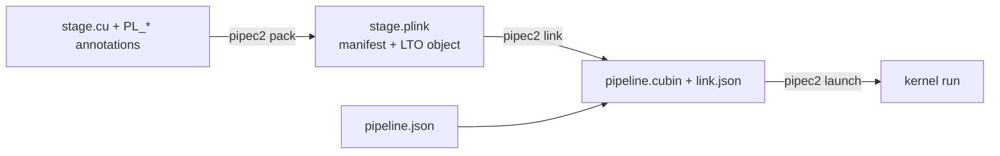

# pipec2: the PipeLink compiler

`pipec2` packs annotated CUDA translation units into opaque stage packages
(`.plink`), checks their contracts against each other, binds their resources and
links them into one kernel. It is the compiler, package format, launcher and
command-line tool of the PipeLink research prototype.



A stage declares what it provides and needs: roles and warp counts, callables,
channel endpoints, resource claims, parameters and, optionally, host-owner and
tensor contracts. The linker derives everything else: resource bases, warp
intervals, ring depths, barrier IDs, the params layout and the dispatch kernel.
Stages stay opaque: a consumer links against a producer's package, not its source.

## Install

Requirements: Linux x86_64, Python 3, [`uv`](https://docs.astral.sh/uv/), a C++17
host compiler (`g++`), GNU `nm`, and **CUDA 13.3** with `nvcc`, nvJitLink and
`cuobjdump`. Packing and linking need no GPU. Running kernels needs a CUDA driver
and a GPU matching the package's profile.

From the repository root:

```sh
git submodule update --init --recursive
uv sync --project pipec --locked
uv run --project pipec --locked pipec2 --help
```

Copy `.env.example` to `.env`, set its machine-local paths, and load the toolkit:

```sh
source tools/env.sh
export CUDA="$PIPELINK_CUDA_HOME"
export PATH="$CUDA/bin:$PATH"
export LD_LIBRARY_PATH="$CUDA/lib64${LD_LIBRARY_PATH:+:$LD_LIBRARY_PATH}"
```

Every profile uses CUDA 13.3; do not substitute another toolkit. The compiler,
the TileLang frontend ([`frontends/tilelang/`](../frontends/tilelang/README.md))
and the megakernel host have separate uv projects. Do not share one environment
across them through `UV_PROJECT_ENVIRONMENT`. Tensor-import links additionally need
the TileLang backend and the include roots listed in
[Tensor imports](../docs/reference/tensor-imports.md#environment).

## Workflow

| Command | Does |
|---|---|
| `pipec2 pack stage.cu -o stage.plink [-I DIR] [-D K=V] [--profile P]` | Compile one annotated TU and record its manifest and symbol attestation. |
| `pipec2 inspect [--json] stage.plink` | Validate a package, check its payload digest and print the manifest. |
| `pipec2 link pipeline.json --out-dir DIR` | Check contracts, solve resources, generate glue and write `pipeline.cubin` and `link.json`. |
| `pipec2 launch DIR/link.json ...` | Launch the linked kernel once, host-less or through owner providers. |
| `pipec2 clauses` | List every diagnostic clause. |

A minimal pair, from [`examples/hello-callable`](../examples/hello-callable/README.md):

```cpp
// provider.cu: a role-less stage that only exports a function.
#include <pipelink/stage.hpp>
extern "C" __device__ float hello_scale(float value) { return value * 2.0f; }
PL_STAGE("org.hello.provider", "1.0.0");
PL_NO_PARAMS();
PL_EXPORT(scale, hello_scale);
PL_CALL(scale, hello_scale, pl::consume, "scale");
```

```cpp
// caller.cu: one four-warp role that calls through a linker-generated trampoline.
#include <pipelink/stage.hpp>
struct HelloCallerParams { const float* input; float* output; unsigned count; };
extern "C" __device__ float pipelink_call_scale(float value);
extern "C" __device__ void hello_call(const void* raw, unsigned variant) {
  const auto* params = static_cast<const HelloCallerParams*>(raw);
  // ... params->output[i] = pipelink_call_scale(params->input[i]);
}
PL_STAGE("org.hello.caller", "1.0.0");
PL_PARAMS(HelloCallerParams, input, output, count);
PL_ROLE(call, hello_call, 4);
PL_CALL(scale, pipelink_call_scale, pl::produce, "call");
```

```sh
uv run --project pipec --locked pipec2 pack provider.cu -o out/provider.plink --profile sm_90a
uv run --project pipec --locked pipec2 pack caller.cu -o out/caller.plink --profile sm_90a
# write out/pipeline.json listing both packages (see T0), then:
uv run --project pipec --locked pipec2 link out/pipeline.json --out-dir out/link
uv run --project pipec --locked pipec2 launch out/link/link.json \
  --grid 4,1,1 --buffer input=input.npy --buffer output=1024:float32 \
  --params params.py:build --output output=result.npy
```

[T0](../docs/tutorials/T0-pack-link.md) and [T1](../docs/tutorials/T1-hello-callable.md)
run this pair end to end, including the pipeline manifest and the params builder.

## Target profiles

`pack --profile` (default `sm_103a`) is the only place an architecture is chosen.
The package's `pipelink_abi.target` stamp carries it, and `link` accepts only
stages stamped for the pipeline's profile. A shared source is packed once per
target; profiles do not translate architecture-specific instructions.

| Profile | Architecture | Not admitted |
|---|---|---|
| `sm_103a` | Blackwell (sm103), the primary target | — |
| `sm_100a` | Blackwell (sm100) | as `sm_103a` |
| `sm_90a` | Hopper (sm90) | TMEM claims (`L-HANDLE`); `scheduler: clc`, `clc-sm100-v1` and `cta_group: 2` (`L-TOPO`) |
| `sm_120a` | Consumer Blackwell (sm120) | as `sm_90a` |
| `sm_121a` | Consumer Blackwell (sm121) | as `sm_120a` |

`sm_100a` and `sm_121a` share every limit with `sm_103a` and `sm_120a` and differ
only in architecture spellings, because an `a` image runs only on its exact
compute capability. They are pack- and link-tested; native results are measured
on the other three profiles. [Profiles](../docs/reference/profiles.md) lists each
profile's capacities, resource domains, layout atoms and tensor catalogue.

## Trust model

**Pack attests the object; link trusts declarations and the packed attestation.**
`pack` checks the declared symbol surface against the compiled object and records
it. `link` checks declarations, compatibility and resource legality, but does not
re-verify objects and cannot detect a manifest that lies about its object.
`inspect` re-checks the payload digest on request; it does not change the model.
Opaque stages are trusted to honor their declarations, so native numerical checks
and sanitizers remain the acceptance evidence for a linked kernel. Details are in
[Pack and link](../docs/reference/pack-and-link.md#trust-model).

## Python interface

| Module | Use |
|---|---|
| `pipec2.launcher` | `open_hostless` / `run_hostless` sessions, and `launch()` for either route. |
| `pipec2.host.broker` | `open_host`: persistent, graph-capturable host ABI v3 sessions. |
| `pipec2.host.cuda` | `CudaBackend`: a loaded kernel, its device context and a setup stream; graph capture. `MulticastGroup`: in-process multicast memory over several backends. |
| `pipec2.host.fixture` | Caller-owned buffers (`Fixture`, `Resource`, `symmetric`) and communication domains (`Domain`). |
| `pipec2.host.provider` | `build_provider`: compile an owner's host provider. |
| `pipec2.host.abi` | `header_path()` for `pipelink_host_abi_v2.h`. |
| `pipec2.container` | `read()` a `.plink` into its manifest and payload. |
| `pipec2.model` | `register_clause()` for new diagnostics. |

Annotation headers live in `src/pipec2/pack/include/pipelink/`; the host ABI
header in `src/pipec2/host/include/`.

## Reference

- [Device annotations](../docs/reference/annotations.md): params, roles, calls,
  endpoints and protocols, claims and lifetimes, topology, variants.
- [Host ABI](../docs/reference/host-abi.md): owner providers, host annotations,
  scheduler schemas and transfer reports.
- [Tensor imports](../docs/reference/tensor-imports.md): linker-generated data
  paths between a producer's placement and a consumer's demand.
- [Pack and link](../docs/reference/pack-and-link.md): pack recipe, manifest
  provenance, link stages and the resource solver.
- [Launching](../docs/reference/launching.md): host-less and host-provider
  launches, sessions, paired control images and multi-device sessions.
- [Clause catalogue](../docs/reference/clauses.md) and
  [Profiles](../docs/reference/profiles.md), generated from the live compiler.

The [documentation index](../docs/index.md) has the tutorial ladder and a
mechanism-by-profile coverage matrix.

## Tests

```sh
uv run --project pipec --locked python -m pytest pipec/tests evaluator
```

GPU-dependent cases skip without matching hardware.
